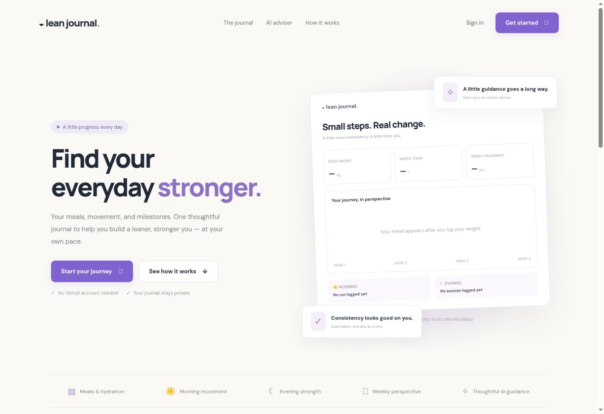
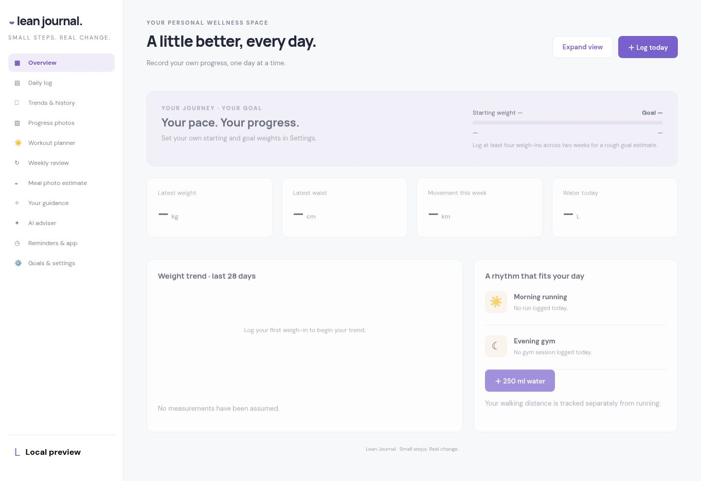

# Lean Journal

**Small steps. Real change.**

A fitness journal for building a consistent routine and understanding progress through your own data. Track meals, hydration, movement, strength training, body measurements, and progress photos in one place.

[Live website](https://lean-journal.vercel.app/) · [Getting started](#getting-started) · [Configuration](#configuration) · [Privacy](#privacy-and-security)

> **Repository status:** This source version of Lean Journal is maintained separately from the current live deployment and has not replaced it. Review account and storage compatibility before connecting this code to existing production data.

## Screenshots

Captured from the local preview. The dashboard starts empty; no personal journal records are shown.

### Landing page



### Journal dashboard



## Overview

Lean Journal turns daily check-ins into a clearer picture of your routine. New journals start empty: weights, goals, meals, photos, and progress are recorded by the person using the app.

Morning running and evening gym sessions stay separate, making it easier to plan, record, and review both activities.

## Features

| Area | Capabilities |
| --- | --- |
| Daily journal | Editable meals, water intake, running, walking, gym sessions, weight, and waist measurements |
| Progress tracking | Weight charts, weekly averages, daily history, and qualified goal projections based on recorded measurements |
| Progress photos | Private uploads, side-by-side comparison, and an adjustable overlay view |
| Workout planning | Separate morning-run and evening-gym plans, recovery days, and calendar exports |
| Profile | Name, age, date of birth, gender, contact email, and profile picture |
| Authentication | Private access keys, verified Firebase email/password login, and password recovery |
| AI adviser | Optional routine guidance, weekly reflections, and editable meal-photo estimate ranges |
| Routine support | Reminders while the app is open, calendar alerts, and installable PWA support |
| Data controls | JSON export, journal deletion, and optional device-only drafts |

## Technology

| Layer | Implementation |
| --- | --- |
| Interface | HTML, CSS, and browser JavaScript |
| Server | Node.js with a Vercel serverless function |
| Storage | Private Vercel Blob storage |
| Email authentication | Firebase Authentication |
| Token verification | `jose` with Firebase public signing keys |
| AI | Google Gemini API |
| Local development | In-memory storage with external server-side services disabled |
| Validation | Node.js tests, syntax checks, and UI-target checks |

## Getting started

### Requirements

- Node.js 22 or newer
- npm
- Git

### Run locally

```sh
git clone https://github.com/MohitKhajuria-jk/lean-journal.git
cd lean-journal
npm ci
npm run build:assets
npm run dev
```

Open **http://localhost:3000/**.

For a disposable, empty preview journal, open **http://localhost:3000/__preview**. This development-only route is not included in the production router.

**Local preview behavior**

- Records stay in memory and reset when the server restarts.
- Server-side Firebase verification and Gemini calls are disabled.
- Use the local private-key journal or the preview route for testing.
- Do not enter real Firebase credentials in the local preview: the browser authentication flow still contacts Google directly.

### Available commands

| Command | Purpose |
| --- | --- |
| `npm run dev` | Start the local preview |
| `npm run build:assets` | Generate the server's bundled browser assets |
| `npm run check` | Check script syntax, inline scripts, and UI targets |
| `npm test` | Run the local regression suite |

Run validation before committing:

```sh
npm run build:assets
npm run check
npm test
```

The included GitHub Actions workflow runs these checks on pushes and pull requests.

## Configuration

See [`.env.example`](.env.example) for variable names and public Firebase configuration. Production server variables are configured in Vercel. The local preview does not require production credentials.

| Variable | Purpose |
| --- | --- |
| `BLOB_READ_WRITE_TOKEN` | Server-side access to the deployment's private Blob store |
| `GEMINI_API_KEY` | Optional server-side key for AI features |
| `GEMINI_MODEL` | Optional model override; defaults to `gemini-3.5-flash-lite` |
| `FIREBASE_PROJECT_ID` | Optional Firebase project override |
| `FIREBASE_API_KEY` | Optional public Firebase web API-key override |
| `FIREBASE_AUTH_DOMAIN` | Optional Firebase authentication-domain override |

Firebase defaults point to the existing Lean Journal project. Use overrides when testing against a separate Firebase project. A Firebase service-account private key is not required.

Without a Gemini key, journal tracking remains available and AI requests report that the service is not configured. Model availability and provider quotas depend on the Google project.

## Deployment

### Start with staging

1. Import this repository into a **new staging Vercel project**, using Node.js 22 and the repository root.
2. Create a **separate private Blob store** and configure `BLOB_READ_WRITE_TOKEN`.
3. Add `GEMINI_API_KEY` if AI features are required.
4. Enable Firebase **Email/Password** authentication and authorize the staging domain.
5. Verify journal creation, login, uploads, email verification, and recovery using an account you control.

[`vercel.json`](vercel.json) routes requests to `api/index.js`. Browser assets are served from the generated `lib/web-assets.js` bundle.

> **Before production:** Existing production cookie formats and historical record compatibility have not been fully verified against this source version. Back up existing data and complete a compatibility or migration review before reusing the production Blob store. Importing this repository does not update the current live site.

## Project organization

| Location | Responsibility |
| --- | --- |
| `api/index.js` | Vercel request adapter |
| `lib/router.js` | API routes, ownership checks, sessions, and journal operations |
| `lib/firebase-auth.js` | Firebase token verification and fresh account-status checks |
| `lib/storage.js` | Private Blob storage and the in-memory test adapter |
| `lib/validation.js` | Input validation and JSON request-size checks |
| `lib/ai.js` | Gemini requests and food-estimate validation |
| `web/` | Editable interface, styles, browser clients, and PWA assets |
| `scripts/` | Preview, asset generation, and source checks |
| `tests/` | Authentication, privacy, feature, signed-token, and calendar tests |

After changing files in `web/`, run `npm run build:assets` and commit the regenerated bundle alongside the source changes.

## Privacy and security

- **Journal isolation:** Records and images use server-controlled journal storage prefixes.
- **Authentication:** App sessions use opaque HttpOnly, Secure, SameSite cookies. Private access keys are bearer credentials and must be kept secret.
- **Explicit email linking:** Users connect a verified Firebase login from an authenticated profile. A matching contact email alone never grants access to a journal.
- **Optional AI sharing:** Questions, selected text logs, or meal photos are sent only after the relevant consent and adult confirmation. Adviser context excludes progress photos and profile contact details.
- **Limited offline caching:** The service worker caches the generic offline page and public icons, excluding private journal pages, API responses, and tokens.
- **Device drafts:** Optional drafts are unencrypted local storage. They require review before cloud saving and are cleared at sign-out.
- **Export and deletion:** JSON exports exclude image files. Journal deletion removes app data and its login-linking index, while the Firebase identity remains separately managed.

Never commit service credentials, session cookies, access keys, or personal journal exports. Firebase web configuration is public; Blob tokens and Gemini keys are server-side secrets.

## Operational limits

- Browser reminders require an open app. Closed-app alerts depend on importing calendar events into a compatible calendar app.
- Calendar exports use local device times.
- Food-photo nutrition estimates are approximate ranges, not measured values. They require review before being appended to a meal log.
- Goal projections depend on available measurements and are uncertain estimates, not promised outcomes.
- AI guidance is general wellness information, not medical advice. Google free-tier processing may include product improvement; the interface discloses this before consent.
- Storage-backed request limits are best effort under concurrency. Use an atomic rate-limit service before substantial public traffic.
- App sessions can last up to 30 days. Resetting a Firebase password does not automatically revoke an already-issued app session; sign-out or journal deletion ends the applicable session access.

## Testing

The regression suite covers:

- Empty journals, authentication, CSRF protection, and cross-user isolation
- Profile validation and date-of-birth age calculation
- Workout plans, recovery days, reminders, and calendar formatting
- Signed Firebase-style tokens, account status, and verified-email requirements
- Email linking, ownership conflicts, session logout, and record preservation
- AI consent, age restrictions, and context minimization
- Private photo access and journal cleanup

Tests use local fixtures and in-memory storage. They do not create Firebase users, send verification emails, or prove live provider delivery.

## Contributing

Keep changes focused, preserve empty defaults and journal isolation, and include meaningful checks for behavior changes. Run the validation commands before opening a pull request. Do not include personal logs or credentials in examples or issue reports.

## License

No license has been granted. Reuse rights remain with the repository owner unless a license is added.
